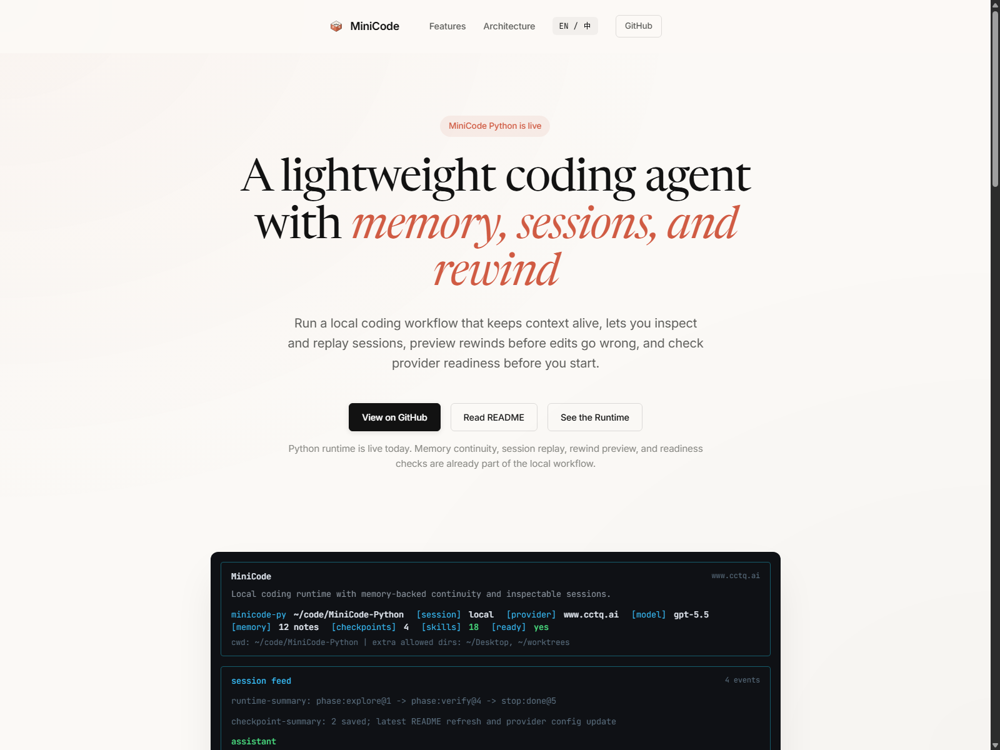

# MiniCode Python

[简体中文](./README.md)

MiniCode Python is a terminal coding assistant for local development. It combines model-driven tool calls with persistent sessions, project memory, edit checkpoints, and runtime diagnostics.



## Features

- Read, search, and edit project files, run shell commands, and execute tests.
- Inspect, save, resume, and replay conversations.
- Retrieve project memory and preserve relevant context across long sessions.
- Preview changes and recover edits with checkpoints and rewind commands.
- Inspect model configuration, provider readiness, and runtime status.
- Extend workflows with local skills and MCP tools.

## Requirements

- Python 3.11 or newer.
- A terminal on Windows, macOS, or Linux.
- Model credentials for live model requests.

## Installation

```bash
git clone https://github.com/FyWing/MiniCode.git
cd MiniCode
python -m pip install -e ".[dev]"
```

Using a dedicated virtual environment is recommended.

## Configuration

Set the model and credentials in `~/.mini-code/settings.json`. For an Anthropic-compatible provider:

```json
{
  "model": "your-model-name",
  "env": {
    "ANTHROPIC_API_KEY": "your-api-key"
  }
}
```

Replace the example values before making live requests. Configure `ANTHROPIC_BASE_URL` when using a compatible custom endpoint. Additional environment variables are listed in [.env.example](./.env.example).

Keep credentials in local settings or environment variables; do not commit them.

## Usage

Start an interactive session:

```bash
minicode-py
```

Run a single task:

```bash
minicode-headless "Explain the structure of this repository."
```

Check provider and runtime readiness:

```bash
minicode-readiness --json --fail-on blocked
```

### Session Commands

| Command | Purpose |
| --- | --- |
| `/help` | List available commands. |
| `/session` | Inspect the current session. |
| `/sessions` | Browse saved sessions. |
| `/session-replay` | Replay session activity. |
| `/memory` | Inspect project memory. |
| `/checkpoints` | List edit checkpoints. |
| `/rewind-preview` | Preview recovery changes. |
| `/rewind` | Recover edits from a checkpoint. |
| `/readiness` | Inspect model and runtime readiness. |

## Runtime Flow

```text
User task -> agent loop -> model -> tools -> verification -> response
                 |                   |
          session and memory   checkpoints and recovery
```

The agent reads the workspace, selects tools, processes their results, and produces a response. Session, memory, and checkpoint data support inspection and recovery during this workflow.

## Repository Structure

| Path | Contents |
| --- | --- |
| `minicode/` | Main Python runtime and command entry points. |
| `Main/` | Application entry contracts and module structure. |
| `Package/` | Shared engineering modules. |
| `tests/` | Python test suite. |
| `benchmarks/` | Evaluation scripts and reports. |
| `Docs/Documentation/` | Architecture and implementation documents. |
| `ts-src/` | TypeScript implementation and embedded Python copy. |
| `openspec/` | Specifications and change plans. |

## Development

Run the Python tests from the repository root:

```bash
python -m pytest
```

Use a separate virtual environment when working with the embedded Python package under `ts-src/py-src/`, since it has the same distribution name as the root package.

## Documentation

- [Chinese README](./README.md)
- [Implementation Notes](./Docs/Documentation/OPTIMIZATION_SUMMARY.md)
- [Memory Architecture](./Docs/Documentation/memory_theory.md)
- [TypeScript Runtime](./ts-src/README.md)
- [Embedded Python Runtime](./ts-src/py-src/README.md)
